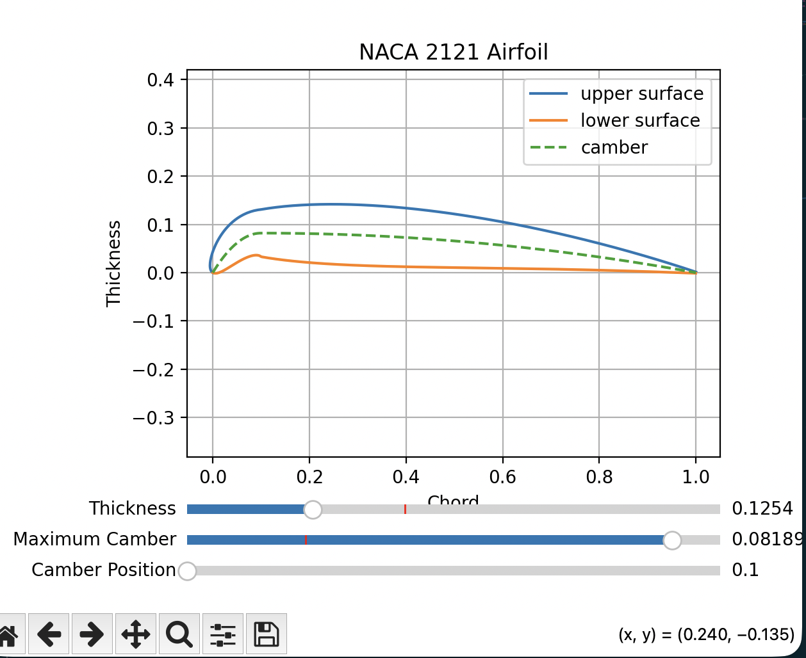

# Airfoil Sandbox

Airfoil sandbox is an interactive webpage that allows the user to visualize a 4-digit NACA airfoil using pyscript.

Airfoils are, essentially, cross sections of wings. They're designed according to a standard equation that considers airfoil thickness, camber position, and maximum camber. 

Camber is kind of like how much curve the airfoil has.

Initially, Airfoil Sandbox was a simple numpy/matplotlib script. It went through multiple iterations.

- First, it took hardcoded values and plugged them into an equation to graph a 4-digit NACA airfoil. 
- Then, I adjusted it to take inputs from the user to graph a particular NACA number -- and whether the user wanted the tail to be closed or not. (Typically, NACA airfoils are modelled with open tails due to the equation describing their shape. However, with a slight modification, the airfoil can be modelled as closed.)
- Lastly, it was adapted to use sliders to control maximum camber, camber position, and thickness.

Here are a few of the equations used to model the airfoil: 

```
    if tail == "yes":
        yt = 5*t*(0.2969*np.sqrt(x)-0.1260*x-0.3516*x**2+0.2843*x**3-0.1036*x**4)
    elif tail == "no":
        yt = 5*t*(0.2969*np.sqrt(x)-0.1260*x-0.3516*x**2+0.2843*x**3-0.1015*x**4)

    if m == 0:
        yc = np.zeros_like(x)
        dyc = np.zeros_like(x)
    else:
        yc = np.where(x >= p, ((m/(1-p)**2)*(1-2*p+2*p*x-x**2)), ((m/p**2)*(2*p*x-x**2)))
        dyc = np.where(x >= p, ((2*m)/(1-p)**2)*(p-x), ((2*m)/p**2)*(p-x))
```

## Check our airfoil.py for the full script.

Sometimes, mishaps with extreme values for camber turn out with these wonky airfoils:



Big thank you to gzuidhof on GitHub for making coi-serviceworker open source. This project's coi-serviceworker.js file is sourced from the Github repo.

--> coi-serviceworker v0.1.7 - Guido Zuidhof and contributors, licensed under MIT

## Coming up: Simulations

Soon, you'll be able to visualize flow over the airfoil you create. Stay tuned.